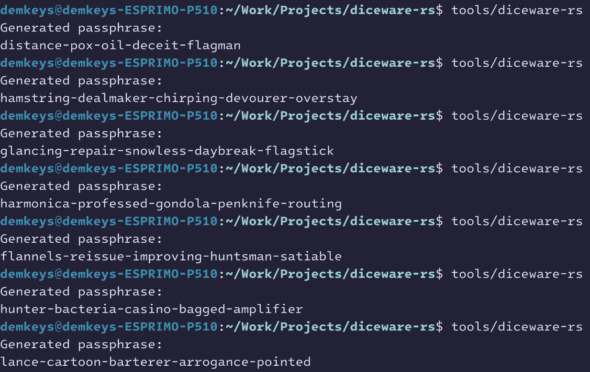

## diceware-rs

Simple passphrase generator that uses the diceware method. The wordlist has been taken from the EFF website and has been embedded into the binary, so the program is self contained and can be placed in any directory to be run.

### Usage
- Binary is in the 'tools' dir. It can be downloaded and run. Program will generate a passphrase, print it out and exit.

---
### TODO
- [ ] More customization options using clap to provide functionality for flags and agrs.
  - [ ] Case (--case)
    - [ ] camelCase
    - [ ] kebab-case
    - [ ] snake_case
    - [ ] PascalCase
    - [ ] SCREAMING_SNAKE_CASE
  - [ ] Include numbers (--numbers)
    - [ ] Attached to one of the words (attached)
    - [ ] Separate from all the words (separate)
- [ ] Set up a way to install binary via cargo install.

